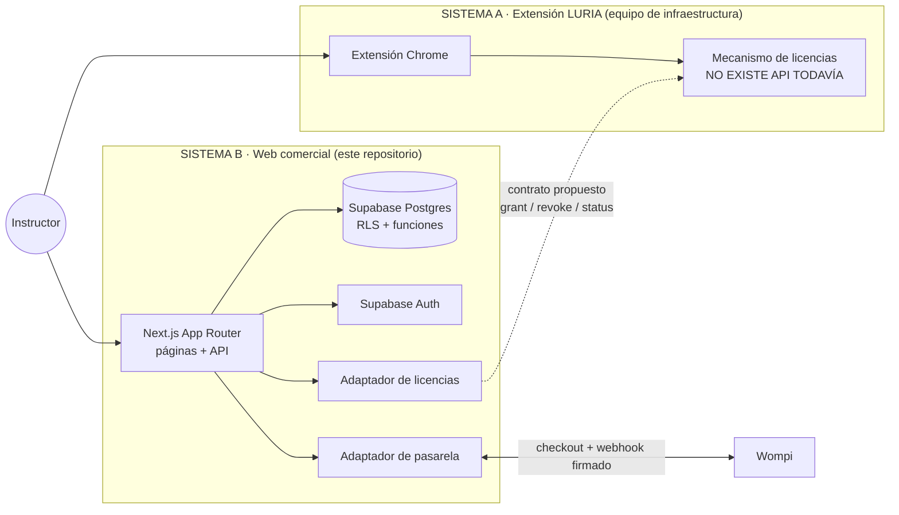
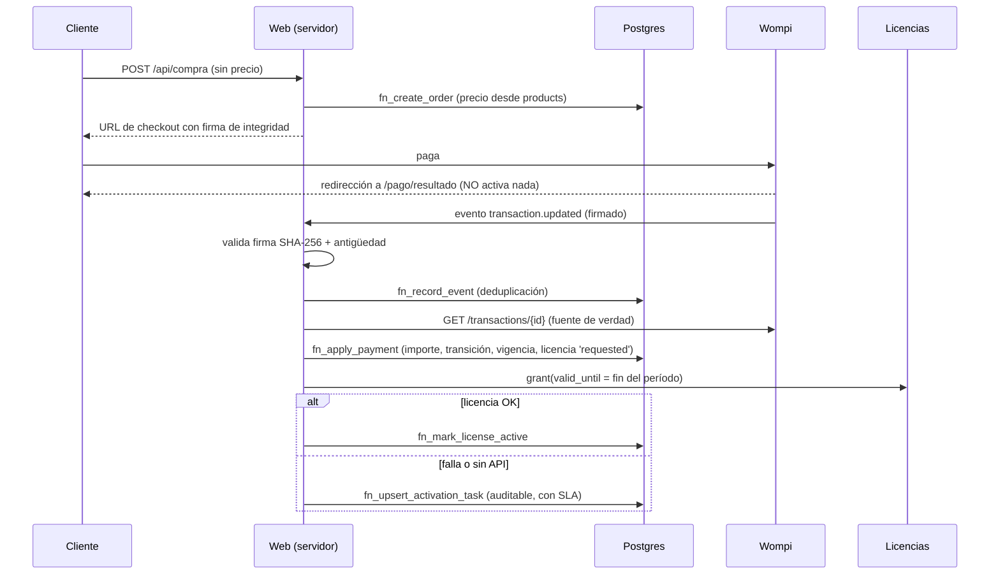

# 1. Arquitectura del sistema

## 1.1 Dos sistemas separados

La web **no** es un segundo sistema académico: no guarda evidencias, notas ni datos de aprendices. Toda función académica permanece en la extensión.

## 1.2 Flujo crítico

Reglas que el diseño garantiza:

- Registro ≠ acceso. Pedido ≠ acceso. URL de retorno ≠ acceso. Solo una licencia `active` con `valid_until` futuro da acceso.
- El precio vive en `products` y un trigger impide crear pedidos con otro importe.
- El estado de pago se confirma consultando a la pasarela, no con el cuerpo del webhook.
- Cuatro estados separados: pedido, pago, suscripción y licencia.

## 2. Justificación de la pila

| Elemento | Elección | Por qué | Alternativa descartada |
|---|---|---|---|
| Framework | Next.js 16 (App Router) + React 19 + TypeScript | Páginas públicas renderizadas en servidor (SEO), API y acciones de servidor en un solo despliegue | SPA + backend separado: dos despliegues para un equipo pequeño |
| Datos y auth | Supabase (Postgres + Auth) | Postgres real con RLS para aislar clientes (A10), funciones transaccionales, auth con recuperación y verificación de correo incluidas | Firebase: sin SQL ni transacciones multi-tabla equivalentes |
| Pasarela | Wompi (adaptador implementado) | Nequi nativo (medio actual de los clientes), PSE, tarjetas, fuentes de pago para recurrencia futura | Ver `03-pagos.md` |
| Estilos | CSS propio con variables | Sin dependencias; el prototipo reutiliza el mismo archivo | Tailwind: otra herramienta más que mantener |
| Validación | zod | Esquemas `.strict()` que rechazan campos inesperados (precio, rol) | Validación manual |

No se añadieron CRM, colas, Redis ni servicios de correo propios: con unos 30 clientes no se justifican (ver §5).

## 3. Entornos

| Entorno | Pagos | Licencias | Datos | Indexación |
|---|---|---|---|---|
| Prototipo (`prototype/`) | Simulados en el navegador | Simuladas | Ficticios, etiquetados | No aplica |
| Desarrollo (`APP_ENV=development`) | `mock` (simulador) | `simulated` | Proyecto Supabase de desarrollo | `robots: Disallow /` |
| Pruebas / staging | Wompi **sandbox** | `pending` o `http` contra el entorno de pruebas de la extensión | Proyecto Supabase aparte | `Disallow /` |
| Producción (`APP_ENV=production`) | Wompi producción | `http` o `manual` con revocación confirmada | Proyecto Supabase de producción | Solo páginas públicas |

`assertSafeConfig` impide arrancar en producción con `mock`, `simulated`, Wompi sandbox o URL sin HTTPS. Las pruebas de sandbox no conceden acceso de producción: usan otro proyecto de Supabase y otro mecanismo de licencias.

## 4. Costos estimados (USD, noviembre de 2026; confirmar antes de contratar)

| Servicio | Plan | Costo | Nota |
|---|---|---|---|
| Vercel | Pro | 20 USD/mes por miembro | El plan Hobby es solo para uso personal y no comercial |
| Supabase | Pro | 25 USD/mes por organización | El plan gratuito pausa el proyecto tras 7 días sin actividad: no sirve para producción |
| Dominio .co | — | ~30–50 USD/año | Por confirmar |
| Wompi | Por transacción | 2,65 % + $700 + IVA ≈ **$2.094 COP por venta de $40.000** | Ver `03-pagos.md` |

Costo fijo aproximado: **45 USD/mes** más comisiones. Con 30 clientes, las comisiones de Wompi rondan $62.800 COP/mes. Alternativa más barata para la fase actual: un VPS con Next.js (`next start`) en lugar de Vercel. Es viable, pero requiere operar TLS, actualizaciones y copias de seguridad.

## 5. Límites y escalabilidad

- **Límite de solicitudes en memoria** (`src/lib/security/request.ts`): suficiente con una instancia. Con varias instancias, sustituir por una tabla en Postgres o un Redis gestionado.
- **Proveedor simulado**: guarda transacciones en memoria; solo funciona en `next dev` (un proceso).
- **Escala esperada**: cientos o pocos miles de suscriptores caben holgadamente en Supabase Pro. Los cuellos de botella previsibles son el soporte humano y la activación manual, no la infraestructura.
- **Tareas programadas**: un cron diario (`vercel.json`, 05:00 hora de Colombia) expira pedidos y suscripciones y revoca licencias.

## 6. Seguridad (resumen)

Ver `06-seguridad-privacidad.md`. Claves solo en el servidor, RLS forzado en todas las tablas, funciones `SECURITY DEFINER` con `search_path` fijo, webhooks firmados e idempotentes, auditoría inmutable, CSP y cabeceras de seguridad, verificación de origen en rutas que cambian estado.
