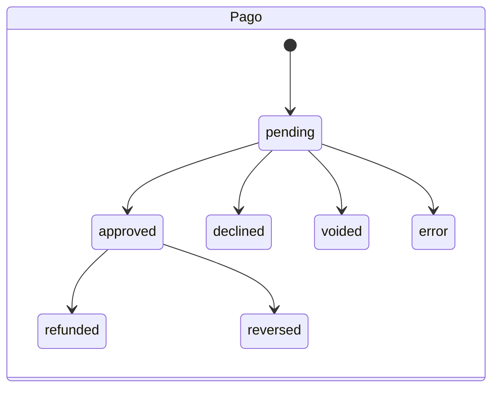

# 2. Modelo de datos

Migraciones en `supabase/migrations/` (aplicar en orden). Probadas en PostgreSQL 16.15 el 10-nov-2026 (`docs/evidencias/pruebas-sql.txt`).

## 2.1 Entidades

| Tabla del brief | Tabla | Claves e índices relevantes |
|---|---|---|
| users | `profiles` (+ `auth.users` de Supabase) | `external_ref` único: identificador ante la extensión, distinto del correo |
| — | `staff_roles` | PK (user_id, role); roles `comercial`, `soporte`, `admin` |
| — | `products` | precio autoritativo (`luria-mensual` = 40.000) |
| environments | `environments` | `verificado` exige evidencia y fecha de prueba (CHECK) |
| features | `features` | `verificada` exige evidencia y versión (CHECK) |
| — | `eligibility_checks` | respuestas del formulario de compatibilidad |
| consents | `consents` | solo inserción; manda el registro más reciente; versión del aviso |
| orders | `orders` | `reference` única con formato; `(user_id, idempotency_key)` único; **un solo pedido pendiente por cliente** (índice parcial); trigger de precio |
| payments | `payments` | `(provider, provider_transaction_id)` único; `discrepancy`; un pago `manual` exige evidencia (CHECK) |
| payment_events | `payment_events` | `dedupe_key` único; estado de procesamiento; intentos |
| subscriptions | `subscriptions` | una por cliente; `anchor_day`; `cancel_at_period_end` |
| — | `subscription_periods` | `payment_id` único → **una vigencia por pago** |
| entitlements / licenses | `licenses` | una por suscripción; `external_license_id` único |
| activation_tasks | `activation_tasks` | `(payment_id, kind)` único; intentos; SLA (`due_at`) |
| support_requests | `support_requests` | categoría cerrada; 10–2000 caracteres |
| attribution | `attribution` + `referrers` + `commissions` | comisión única por pago; solo referidos autorizados |
| — | `analytics_events` | sin datos personales; `path` no admite `@` |
| audit_log | `audit_log` | trigger que impide UPDATE/DELETE |
| Entrega del acceso | `access_grants` | Una fila por cliente: estado (`pendiente`, `enlace_guardado`, `habilitado`, `suspendido`, `revocado`), enlace `https://`, quién guardó y quién habilitó, y cuándo. Solo el personal de operación la lee; solo las funciones escriben |
| Notificaciones | `notifications` | Avisos dentro de la cuenta del cliente; cada cliente lee las suyas y solo puede marcarlas como leídas |

No existe ninguna tabla con datos académicos, evidencias, aprendices ni contraseñas institucionales.

## 2.2 Estados

| Pedido | Pago | Suscripción | Licencia |
|---|---|---|---|
| pending_payment, paid, expired, cancelled, failed, refunded | pending, approved, declined, voided, error, refunded, reversed | pending_activation, active, activation_failed, expired, revoked | requested, active, expired, revoked, failed |

Transiciones de pago (`fn_decide_payment`, igual a `decidePaymentTransition` en TS):

- mismo estado → `noop` (duplicado)
- rango menor (p. ej. PENDING tras APPROVED) → `noop` (evento atrasado)
- dos estados finales distintos → `conflict` (revisión humana, sin cambios)
- reembolso o reversión solo desde `approved`

## 2.3 Funciones transaccionales

**Pago y acceso (migración 0008):**
- `fn_payment_state(usuario)` calcula el estado de pago.
- `fn_access_save_link`, `fn_access_enable` y `fn_access_revoke` son solo para admin: verifican el rol dentro de la función, exigen suscripción vigente para habilitar y dejan auditoría y notificación.
- `fn_my_access()` es la vista del cliente: el enlace solo llega si el acceso está habilitado y la suscripción vigente.
- `fn_admin_access_overview()` alimenta la tabla del personal.
- El trigger `subscriptions_access_follow` suspende el acceso al vencer la suscripción y lo revoca ante un reembolso o una reversión.

| Función | Quién la llama | Qué hace |
|---|---|---|
| `fn_create_order(user, idem)` | servidor | Reutiliza el pedido pendiente o crea uno con el precio vigente |
| `fn_record_event(...)` | servidor | Inserta o detecta un evento duplicado |
| `fn_apply_payment(...)` | servidor | Verifica importe, aplica la transición, crea la vigencia, la licencia `requested` y la comisión; en reembolso revoca. Bloquea el pedido con `FOR UPDATE` |
| `fn_mark_license_active / revoked` | servidor | Sincroniza la licencia y cierra tareas |
| `fn_upsert_activation_task` | servidor | Tarea idempotente con SLA |
| `fn_register_manual_payment` | servidor (admin) | Pago manual con evidencia; exige rol admin; referencia externa irrepetible |
| `fn_cancel_renewal / fn_resume_renewal` | cliente autenticado | Solo sobre su propia suscripción |
| `fn_expire_due(now)` | cron | Expira pedidos y suscripciones; devuelve licencias a revocar |

## 2.4 Políticas de acceso (RLS)

| Recurso | Cliente | Comercial | Soporte | Admin | Anónimo |
|---|---|---|---|---|---|
| Catálogo (products, features, environments) | leer | leer | leer | leer/editar | leer |
| Su perfil | leer; editar nombre y teléfono | leer perfiles | leer perfiles | leer | — |
| Pedidos | propios | todos | todos | todos | — |
| Pagos | propios | todos | — | todos | — |
| Suscripciones y vigencias | propias | todas | todas | todas | — |
| Licencias | propia | — | todas | todas | — |
| Eventos de pago, auditoría | — | — | — | leer | — |
| Tareas de activación | — | — | leer | leer | — |
| Soporte | crear y leer propias | — | leer y cambiar estado | leer y cambiar estado | — |
| Atribución, referidos, comisiones | — | leer | — | leer | — |
| Analítica | — | leer | — | leer | — |

Escrituras financieras: ningún rol de usuario tiene INSERT/UPDATE sobre pedidos, pagos, suscripciones o licencias. Solo las funciones del servidor (service role) escriben. Probado en `supabase/tests/20_rls.sql`.
